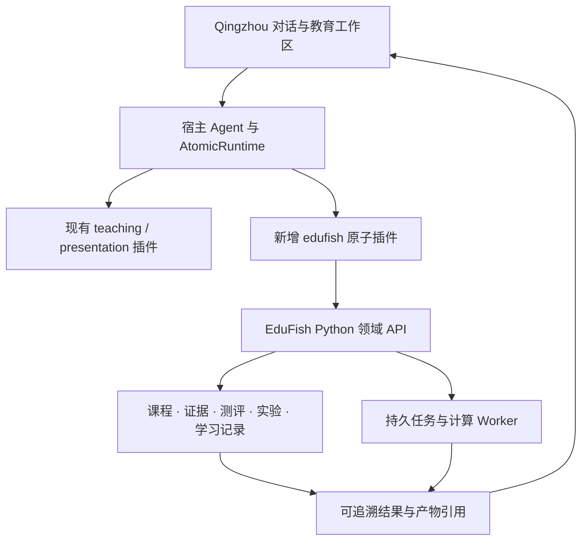

# EduFish 接入 Qingzhou：现状评估与实施建议

评估日期：2026-10-26。依据本地源码、Git 状态和 GitHub 实时分支信息；本轮没有合并、切换分支、修改业务代码或运行验收测试。以下接口名若无特别说明，均为建议设计，不代表已经实现。

## 1. 建议结论

将 Cognitive-AI / EduFish 收敛为 **Qingzhou 的教育领域能力包**：Qingzhou 提供用户入口、对话编排、插件生命周期和作品消费；EduFish 提供课程、教材证据、学习活动、实验及学习记录。

优先采用 **Qingzhou 原生 AtomicPlugin + Python HTTP 领域服务 + 按需迁移的交互面板**。MCP 可作为后续面向其他宿主的适配，不作为第一阶段必须经过的中间层。

不要把整套 Vue 平台、Node Agent Runtime 和 Python 引擎同时搬入 Qingzhou。也不要先完成一套独立插件市场再开始业务集成。先证明一个真实教学闭环，再推广扩展协议。

## 2. 当前版本地图

| 位置 / 分支 | 已核实状态 | 对集成的影响 |
| --- | --- | --- |
| Cognitive-AI 本地 `main` | `ca514ba`；相对已核实远端 `main` 领先 5、落后 3；另有未提交前端改动和未跟踪文件 | 先盘点两边能力，避免整树覆盖或直接拉取造成冲突 |
| Cognitive-AI GitHub `main` | `c4cc419`；新增 AgentOS、项目内实现的 Cordis 风格内核和领域插件 | 需要区分真实服务连接与演示实现 |
| `E:/Project/Qingzhou` | 本地 `main=223fa628a`，落后 GitHub `main` 17 个提交；Compose 和 package.json 有未提交改动 | 不适合原地切换成集成开发环境 |
| Qingzhou GitHub `main` | `f05be3d8c` | 当前已合并能力的核对基线 |
| Qingzhou GitHub `canary` | `223fa628a` | 仓库 AGENTS 规定从 canary 开分支并向其提 PR，但该分支目前落后 main；需先统一流程与实际版本 |
| 本地 PPT 工作树 | `C:/Users/shiro/.codex/worktrees/9e74/Qingzhou`，`feat/ppt-template-composition=eb04cb1b1`；有未跟踪 output 目录；该提交已在远端 main 历史中 | 分支名相同不代表进度相同 |
| GitHub 同名 PPT 分支 | `7f52996bf`；领先远端 main 4 个提交，新增音乐工作台、音频上传与播放 | 不能用本地同名分支代替远端状态；教育插件无需预先合入音乐功能 |
| `E:/Project/Qingzhou-local-91d8b9531` | 无 `.git`；RUNTIME_SOURCE.json 记录来源提交 `91d8b9531`，RUNNING.json 记录本地启动调整与数据位置 | 这是运行目录副本；其中启动修复应单独核对并回迁，不能作为可追溯开发分支 |

上述差异均为评估时快照。没有执行 fetch，因此没有更新本地远端跟踪引用；关键远端 SHA 通过 GitHub 连接器另行核实。

远端证据：[Qingzhou 分支](https://github.com/shiro123444/Qingzhou/branches)、[主线与功能分支比较](https://github.com/shiro123444/Qingzhou/compare/main...feat/ppt-template-composition)、[Cognitive-AI 远端重构](https://github.com/shiro123444/Cognitive-AI/commit/c4cc41946fb4e453f3c6d00b86a56b4f705a0686)。

## 3. 应复用的能力与应收敛的重复建设

| 能力 | 现有证据 | 建议归属 |
| --- | --- | --- |
| 课程 / 章节 / 活动 / 作业 / 学习进度 | EduFish models.py、course_service.py、activity_service.py、progress_service.py | EduFish 保持领域数据权威来源 |
| 课程检索与知识图谱 | Python course_tools.py 已调用 EmbeddingClient、MaterialService 和实际图谱模型 | 保留并通过受控接口暴露 |
| 实验任务、产物与报告 | ExperimentRun / ExperimentArtifact / ExperimentReport 和 experiment_service.py | 保留 Python 领域实现；宿主消费任务状态与产物引用 |
| 插件宿主与 Agent 入口 | Qingzhou AtomicRuntime、CordisAtomicHost、cordis-runtime profiles | 复用 Qingzhou；集成路径不再经过 EduFish 独立 Agent 循环 |
| 教学设计 | Qingzhou 已有独立 teaching 插件：lesson.plan / compile / revise / validate 和教学经验检索 | EduFish 补课程证据、测评与反馈，避免再做同一套教案编排 |
| 演示文稿、作品与素材 | Qingzhou presentation 插件及资产桥接 | 通过公开业务适配器组合，保留原有作品归属与版本控制 |
| 图谱与脑影像交互 | EduFish Vue、D3、NiiVue；当前库入口只导出图谱相关组件和函数 | 首期复用专用视图，逐步建立 React 面板；现有库包不能直接覆盖全部实验 UI |

关键区别：Cognitive-AI 远端 `runtime/src/domain/rag.ts` 的 `edu_rag_search` 返回固定示例引用，并未连接现有 Python 检索服务；`runtime/src/cordis/context.ts` 是仓库自实现。不能仅凭提交标题认定与 Qingzhou 的真实 Cordis 宿主兼容，也不能把这些示例结果算作真实闭环。

Qingzhou 主线的 [AtomicRuntime](https://github.com/shiro123444/Qingzhou/blob/f05be3d8ca5e5fa9567373be5d90469774ee6490/src/server/runtime/atomic-runtime.ts) 和 [teaching 插件](https://github.com/shiro123444/Qingzhou/blob/f05be3d8ca5e5fa9567373be5d90469774ee6490/src/server/runtime/teaching/atomic-plugin.ts) 已提供相应扩展入口。不过“注册为工具”“供 Agent 发现”“允许 HTTP 调用”是不同环节，集成必须逐层接通。

## 4. 目标边界

### 4.1 插件接口

插件 ID 建议为 `edufish`，符合当前宿主单段 ID 与操作前缀规则。第一期选择少量稳定操作：

- `edufish.course.read`：读取已授权课程及章节。
- `edufish.material.search`：返回教材片段及来源定位。
- `edufish.graph.neighborhood`：按概念展开课程图谱。
- `edufish.quiz.create`：根据指定知识点创建有版本的测验。
- `edufish.quiz.submit`：提交答题、评分并记录学习事件，支持请求去重。
- `edufish.progress.read`：读取当前学习者的进度和可解释薄弱点。

实验在第二阶段增加 `edufish.lab.start`、`edufish.lab.status` 和明确支持的取消操作。长任务返回任务 ID，后续查询或订阅结果；不让一次工具调用一直等待全部计算。

外部调用先复用 Python 服务层。现有 `/runtime/capabilities` 与 `/runtime/capabilities/invoke` 可减少接线工作，但不能原样把全部注册工具公开给宿主。适配器应采用明确允许列表、输入输出校验与逐资源授权。

### 4.2 身份与数据边界

- Qingzhou 用户身份由宿主认证上下文注入，建立与 EduFish 学习者的稳定映射；模型参数不携带可伪造的身份或角色。
- 用户、课程成员关系和租户权限在服务端核实。当前 EduFish 的部分工具按 course_id 直接查询，租户中间件从请求头读取租户；需要在开放宿主调用前落实可信映射和查询限制。
- Qingzhou 现有原子 scope 是 userId + sessionId。学习历史需要跨会话保留，课程也可能多人共享；因此领域数据按用户 / 课程授权访问，sessionId 用于调用追踪，不作为学习历史唯一归属。
- 课程、测验、学习事件在 EduFish 保持权威记录；Qingzhou 保存交互状态、作品与引用，避免双写两套课程数据库。
- 跨服务凭据应绑定受众、有效期与用户上下文。当前 runtime-token 在 ENGINE_API_KEY 为空时允许匿名签发，不能直接复用这一默认行为作为对外集成认证。

### 4.3 证据、产物与恢复

- 教材检索至少返回 materialId、chunkId、页码 / 章节定位与来源版本；图谱边保留证据引用。
- 实验结果至少记录数据版本、参数、算法版本、执行状态与产物引用。不要将生成图像当作实验测量。
- 学习事件使用稳定事件 ID 或幂等键；同次测验重复提交和网络重试不重复计分。
- 宿主 runId、领域 jobId 和 artifactId 通过关联记录连接，不强行合并成一个生命周期。
- Python 当前线程池队列可用于原型，但不保证进程重启后恢复执行。实验阶段按持久队列、重试、取消与中断恢复需求改造。
- 原子插件卸载不删除学习历史。宿主的进程内版本 lease 也不等于跨重启恢复旧实现，需保存领域任务所用版本。

### 4.4 UI 与现代化取舍

Qingzhou 使用 React / TypeScript，现有前端使用 Vue / JavaScript。首期把教育入口、结果卡片、测验和进度做成原生宿主体验；图谱和 NiiVue 实验面板可先通过受控嵌入复用，再按价值迁移。嵌入需要明确来源、短期授权及经过校验的消息协议，不能直接传长期登录令牌。

优先现代化接口契约、真实数据连接、任务恢复和结果复用。保留 Flask 与现有检索实现，依据实际瓶颈再决定框架或向量存储迁移；不把换框架本身当成现代化成果。

现有 EDUFISH-NEXT-ARCHITECTURE.md 设想 EduFish 自建控制面、插件安装系统与 Agent Runtime。若采用本方案，应调整为 Qingzhou 宿主方向，避免两套平台同时扩张。

## 5. 第一条完整闭环

场景：在 Qingzhou 中选择一门课，基于上传教材解释一个知识点，完成小测，记录学习结果，并继续生成复习材料。

1. 选择或导入真实课程材料，确认该用户可访问。
2. 通过 Python 实际检索返回可点击定位的片段；没有证据时明确缺失，不回退到固定示例。
3. 宿主 Agent 结合证据讲解；需要备课时调用已有 teaching 插件。
4. 创建测验并在学生界面隐藏答案；提交后评分、反馈并写入学习事件。
5. 再次进入会话能够读到该次学习结果和薄弱知识点。
6. 根据结果生成复习摘要或组合现有 presentation 能力生成课件，保存课程 / 证据 / 测验引用。

完成标准：真实材料来源可查、工具调用可追踪、结果落库、重试不重复计分、换会话可继续、越权课程访问被拒绝。生成一份 PPT 本身不算学习闭环完成。

教师反馈闭环可在下一阶段基于实际答题结果给出教学调整建议；教师确认的教学经验继续进入 Qingzhou 现有 teaching memory，避免另建一套同义存储。

## 6. 实施顺序与交付边界

| 阶段 | 交付 | 验收 |
| --- | --- | --- |
| P0：版本与契约 | 记录两个仓库 SHA、未提交改动清单、运行目录修复清单；确定分支策略与身份 / 课程映射 | 可从干净代码和明确配置重建集成环境；不依赖运行目录中的隐含修改 |
| P1：只读能力 | 原生 edufish 插件、课程读取、真实检索与图谱；宿主认证路由及 Agent 发现连接 | 一次实际对话产生可定位教材证据；无权限时拒绝访问 |
| P2：学习闭环 | 测验、提交、进度回写、跨会话恢复；组合已有 teaching / presentation | 重复提交不重复写入；学习结果可在新会话读取并用于复习 |
| P3：实验闭环 | NeuroLab 任务、状态 / 事件、产物登记、持久 Worker 和专用面板 | 启动、失败、重试 / 中断恢复按声明工作；产物可追溯并供报告使用 |

代码交付建议拆成小 PR：契约与服务适配 → 插件与只读接线 → 测评回写 → 教育面板与端到端验证。每一步都有真实用户路径，不以单独添加 manifest 或演示卡片作为阶段完成。

Qingzhou 的基线以远端 main 的已合并能力核对；实施前需解决 canary 落后的流程问题。若保留 AGENTS 当前规则，应先把需要的主线能力同步到 canary，再从 canary 建集成分支、向 canary 提 PR。若决定以 main 为开发主线，应同步修改仓库约定和相应 CI。此次评估未改变这些分支或规则。

## 7. 最先应做的工作

先完成 P0 和 P1：建立可复现基线，并做出“Qingzhou 对话 → edufish.material.search → Python 真实课程检索 → 带引用结果”的纵向切片。这个切片会同时检验宿主插件发现、身份映射、课程权限、证据协议和服务部署，是后续测评、实验与课件组合的共同基础。

本轮是源码与版本评估，尚未执行服务启动、真实模型调用或完整测试；方案中的验收项是后续实现要求。
