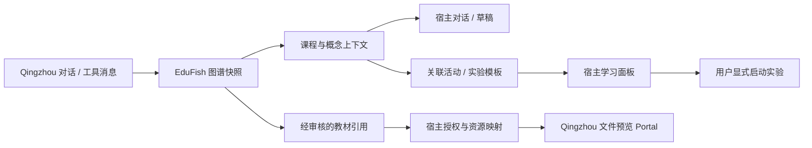

# 图谱与 Qingzhou 宿主衔接契约

更新：2026-11-09。实现范围为本仓库中的领域服务、无 UI 插件和 React 适配层。Qingzhou 内的注册、可信身份映射、文件映射和 Portal 接线仍待实际接入验收。

## 职责与上下文

| Qingzhou 负责 | EduFish 负责 |
| --- | --- |
| 登录身份、会话、Agent 编排、工具生命周期 | 课程、概念、关系、教材证据和活动关联 |
| 消息历史、主题、语言、工具渲染和 Portal | 测验提交、实验运行和权威学习事件 |
| 宿主资源授权、文件预览、对话草稿 | 按课程与个人知识权限返回领域引用 |

课程图谱是对话、教材与活动之间的关联层。公共概念定义、个人知识和个人学习记录保持各自归属；浏览概念或答题次数不等于掌握度，也不改写公共概念。



图中的宿主动作通过回调承接。适配包不会创建新的应用壳、认证入口或 Agent Loop。

## 图谱读取与兼容

原操作保持八项不变。`edufish.graph.neighborhood` 新增可选布尔参数：

```json
{
  "course_id": "course-001",
  "concept_id": "concept-001",
  "depth": 1,
  "limit": 50,
  "include_context": true
}
```

未提供或显式关闭 `include_context` 时，输出仍只有 `{nodes, edges}`。TypeScript 不会给旧调用自动补入这个参数，因此新客户端仍可向旧 v1 服务发送原有调用。`null`、字符串和数字不会被转换为布尔值。

宿主启用扩展前，应检查后端 manifest 中该操作的 `input_schema.properties.include_context`，并配套使用支持该扩展的核心包与渲染包。旧的 strict 渲染器不能读取含新 context 的快照；保留旧请求格式不代表旧渲染器可以读取新格式。未来改变扩展的含义或必填字段时，必须增加 context 版本或另设协商能力。

开启后，原节点和边不变，增加：

```ts
interface GraphContext {
  version: 1;
  course_id: string;
  snapshot_id: string;
  concepts: Array<{
    concept_id: string;
    sources: GraphSourceReference[];
    activities: Array<{
      activity_id: string;
      chapter_id: string | null;
      title: string;
      activity_type: string;
    }>;
    experiments: Array<{
      template_id: string;
      title: string;
      adapter: string;
    }>;
  }>;
  edges: Array<{ edge_id: string; sources: GraphSourceReference[] }>;
}

interface GraphSourceReference {
  course_id: string;
  material_id: string;
  chunk_id: string;
  filename: string;
  page_number: number;
  citation_locator: string;
  content_sha256: string;
}
```

`snapshot_id` 是本次可见节点、边与上下文的 SHA-256 摘要；相同内容得到相同值。它标识读取快照，不是全局图谱事务版本、授权凭证或教材文件版本。`content_sha256` 单独标识发布时引用的 UTF-8 片段文本。

完整性校验要求 context 的概念和边与实际返回集合一致，来源课程与 context 一致，且同一对象不能重复引用同一片段。实时调用还校验返回的课程及是否启用 context 与请求一致。每个对象最多十条来源，每个概念最多二十项活动和二十项实验；节点、边继续受原有上限约束。关联活动和模板各查询最多前 2000 个候选，按 ID 确定性排序，当前接口不提供关联分页。

## 来源保存与可见性

`GraphEvidence` 是领域模型中的新增关联表，不属于宿主消息状态或用户长期记忆。它将概念或关系关联到真实 `Chunk`，保存发布时的内容哈希。现有概念、边和教材表不增加必填列；通过现有数据库建表流程创建新增表。本次本地验证只使用临时数据库，未升级用户现有数据库。

手工和自动发布都校验 `evidence_chunk_ids`：

- 片段必须存在，并属于该对象的课程。
- 公共知识只能引用公共教材；个人知识可引用公共教材或同一所有者的同类个人教材。
- 自动发布按最终生效的 scope/owner 校验，不能通过发布参数将私人来源提升成公共证据。
- 新发布会替换该对象之前的来源关联；无来源的旧载荷仍可发布，但不会保留已经失去依据的旧关联。
- 重新切分教材会清除被替换片段的来源关联；新增外键支持级联删除，SQLite 未启用外键时也会显式清理相关关联。

材料提取上下文包含真实片段 ID；生成的证据 ID 只能来自本次提供的片段。无模型的简单提取可引用实际使用的首个片段。校验片段身份和权限不等于已经自动证明关系在语义上成立，内容审核仍沿用原有流程。

图谱读取再次过滤教材课程及当前用户权限，并检查片段内容是否仍与保存的哈希相同。缺失、已变更或不可见的来源被省略，不从 evidence 文本、文件名或相似检索结果推造引用。既有图谱没有结构化关联时，来源列表为空；旧 evidence 文字仍作为原有说明展示。

跨课程边不会授予另一门课程的访问权限。当前操作仍限制在明确请求的课程中；跨课程聚合需要另设双方授权与查询契约。

关联活动仅包含本课程中已发布且已到发布时间的记录；关联章节也必须属于本课程。实验仅来自已持久化、已发布且显式关联该概念的模板。读取图谱不会补写默认模板、启动运行或记录学习事件。活动配置、答案、launch_url 和模板参数不随引用返回。

## React 与宿主动作

`EduFishUIProvider` 接受以下可选回调，工具结果注册表会将它们传到 `GraphResult`：

| 回调 | 明确触发点 | 参数用途 |
| --- | --- | --- |
| `onFocusConcept` | 用户选择节点 | 更新宿主当前概念上下文 |
| `onAskConcept` | 点击继续提问 | 宿主构造问题草稿或进入已有对话流程 |
| `onOpenReference` | 点击打开原文 | 宿主授权并解析 EduFish 资源引用 |
| `onOpenActivity` | 点击关联活动 | 宿主解析活动并打开学习面板 |
| `onOpenExperiment` | 点击关联实验 | 宿主打开实验面板；运行仍需用户显式启动 |

概念动作携带 `course_id`、`concept_id`、`label`、`graph_snapshot_id`；由工具消息渲染时，另携带宿主传入的 `origin.messageId` 和可选 `origin.toolCallId`。活动或实验动作同时包含相应引用。业务上下文不接受模型指定的 userId、sessionId 或访问令牌。

可信身份仍由 Provider 的 `getInvocation()` 提供；服务端从有效 Bearer JWT 和数据库用户核实权限。Qingzhou 的 `topicId`、`threadId`、运行时 `sessionId` 和课程 ID 不是同一个概念，不能直接互相改名。当前 HTTP 边界仍要求有效 EduFish 用户 JWT，不能假定 Qingzhou 登录令牌可直接使用。

只读结果不依赖 Provider 也可以显示。缺少 context 的旧快照继续显示图谱；缺少对应回调时不显示宿主动作入口。挂载、StrictMode 重放、历史重放、主题/语言切换和快照替换均不会自动触发回调或 API 请求。宿主若需要当前数据，应通过单独的显式读取更新面板，保留原消息快照。

## 资源映射与 Portal

EduFish 的 `material_id` / `chunk_id` 不能作为 Qingzhou 的 `fileId` / `chunkId` 使用。本次提供结构化引用与回调，尚未实现生产资源映射表或解析服务。

宿主解析器需要在可信服务端同时校验原课程资源和目标宿主资源的授权，核对片段内容哈希及映射的文件版本，再返回可供宿主预览的数据。两边切分策略不同时，映射可能是一对多，不能假设片段 ID 一一对应。

本机 Qingzhou 基线 `main@223fa628a6b5d14032cc6bc3d7fbd12e2a0ad3d9` 中，已有聊天 store 的 `openFilePreview({fileId, chunkId, chunkText})`、`openDocument(documentId)` 和 `openToolUI(messageId, identifier)` 等 Portal 动作；引用组件已有打开文件预览的用法。此处依据本地源码，未 fetch 远端，不能代表最新线上能力。具体资源解析器与教育 Portal 仍需宿主适配。

回调失败应由宿主显示其现有错误提示，避免未处理的异步拒绝。未经授权、已删除或版本不匹配的来源不能退化为直接文件路径、任意 URL 或跨应用跳转。

## 验证入口与后续接线

- 核心协议：`npm --prefix packages/edufish-plugin test`。
- 后端：`test_graph_provenance.py`、`test_plugin_graph_context.py`，以及既有插件、教材和发布测试。
- React：`test/graph-host-actions.test.tsx`，以及既有快照和注册表测试。
- 真实 HTTP：`npm run plugin:smoke`，同时验证旧图谱输出与 opt-in 来源、活动和实验引用。
- 开发预览：真实 HTTP 模式的图谱结果经过 `EduFishToolResult` 与 Provider，记录宿主动作参数；打开实验显示本机面板，仍需显式点击才运行。探针不打开真实 Qingzhou 文件或发送消息。
- CLI：`node examples/plugin-host/cli.mjs graph --course-id course-fixture-published --include-context`，认证与 fixture 启动方式沿用 [插件指南](README.md)。

实验关联现已继续贯通到显式启动、持久化上下文和本人完成证据：`lab.start` 可选接收 `learning_context`，校验章节、实验活动、概念及模板关系；`lab.status` 与 `progress.read` 分别可显式返回上下文和已完成运行引用。宿主消息来源继续由宿主管理，图谱摘要仅是调用方提供的关联值。打开面板不启动运行，启动次数不等于完成，计算完成也不自动完成活动或推断掌握度。准确类型、兼容策略、事务和验收入口见 [实验学习上下文契约](LAB-LEARNING-CONTEXT.md)。

真正接入 Qingzhou 还需完成可信身份与资源映射、AtomicOperation 及 Agent discovery 适配、静态 Render/Inspector/Streaming 注册和教育 Portal。验收应在真实宿主中完成“对话 → 概念 → 原文 → 继续提问或实验”的完整链路；本地 HTTP 和预览通过不能替代宿主验收。

## 图谱阶段本地验证（2026-11-09）

以下为图谱阶段记录；后续实验学习上下文的协议与验收入口见 [LAB-LEARNING-CONTEXT.md](LAB-LEARNING-CONTEXT.md)。

| 检查 | 结果 |
| --- | --- |
| 核心插件完整测试 | 7 文件、70 项通过 |
| 后端、BCI 与 fixture 回归 | 456 项通过；使用独占临时数据库和 pytest 目录 |
| React 适配包完整测试 | 10 文件、119 项通过；单 worker 调度 |
| built plugin → 正式路由 → 临时 fixture HTTP | 80 项检查通过 |
| Chromium 真实界面操作 | 概念选择、提问、原文、活动、实验导航通过；宿主 message/tool 来源及片段哈希正确 |
| Chromium 挂载与主题/语言切换 | 整段操作仅一次显式图谱读取、零测验/实验写请求、零控制台错误 |
| 构建 | 核心包、React 包、开发预览均通过 |

浏览器中宿主动作由验收探针记录，不代表 Qingzhou 已完成注册。测试环境仍有既有 jsdom canvas/组件警告；预览构建仍有大于 500 kB 的 bundle 提示。实际 Chromium 的图谱路径未出现相应运行错误。
