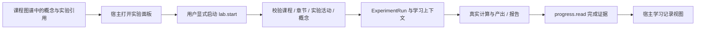

# 实验学习上下文与完成证据

更新：2026-11-09。范围为 EduFish 领域后端、无 UI 插件、React 适配包和本机验收预览。Qingzhou 的身份映射、工具注册、资源解析及教育 Portal 仍需在真实宿主中接线验收。

## 数据如何贯通

Qingzhou 管理身份、会话、工具消息与学习面板；EduFish 保存课程资源关联、实验运行、科学产出和学习记录。图谱中的实验动作先打开面板，运行由用户显式启动。



`ran_lab` 在创建运行时记录，代表一次启动尝试。完成证据来自状态为 `completed` 且已有 `completed_at` 的运行行，不来自启动次数、通用 `completed` 事件或队列任务状态。成功计算不会自动完成章节或活动，也不改变公共概念或推断掌握度。

## 协议与兼容

保持八项操作、插件版本 `0.1.0` 和协议版本 `1`。扩展按调用显式启用：

| 操作 | 新输入 | 新输出 |
| --- | --- | --- |
| `edufish.lab.start` | 可选 `learning_context` | 仅在提供输入时返回顶层 `learning_context` |
| `edufish.lab.status` | 可选 `include_context: true` | 顶层 `learning_context` |
| `edufish.progress.read` | 可选 `include_lab_evidence: true` | 顶层 `lab_evidence` |

未提供扩展，或将读取开关设为 `false`，继续得到原有输出。`run` 内部始终保持原有 `ExperimentService.serialize_run` 结构。新客户端不会为旧调用自动补入这些可选字段；旧服务仍能接收原有请求。

宿主启用前需要检查服务端 manifest 中相应操作的 `input_schema.properties`，并配套使用支持扩展的核心包和渲染包。旧 strict 渲染器不能读取含扩展的新快照。`null`、数字和字符串不会转换为布尔开关。

启动示例：

```json
{
  "operation": "edufish.lab.start",
  "request_id": "host-generated-run-request-id",
  "arguments": {
    "course_id": "course-fixture-published",
    "template_id": "exp-neuron-spike",
    "params": {"stimulus_current": 8, "duration_ms": 120},
    "learning_context": {
      "activity_id": "activity-fixture-neuron",
      "concept_id": "concept-neural-networks",
      "graph_snapshot_id": "<64位小写十六进制摘要>"
    }
  }
}
```

`learning_context` 是 strict 对象，只允许 `chapter_id`、`activity_id`、`concept_id` 和 `graph_snapshot_id`。前三项至少提供一项；图谱摘要要求同时提供概念。ID 必须为非空、无控制字符、最多 200 字符的字符串；摘要必须为 64 位小写十六进制。显式 `null`、空对象和宿主身份字段会被拒绝。

返回上下文的完整类型：

```ts
interface LabLearningContext {
  version: 1;
  course_id: string;
  chapter_id: string | null;
  activity_id: string | null;
  concept_id: string | null;
  graph_snapshot_id: string | null;
}

interface LabOutput {
  run: ExperimentRun; // 原有结构保持不变
  learning_context?: LabLearningContext;
}
```

只提供实验活动时，服务端从活动推导章节。只提供概念或章节也可启动。为旧运行显式读取上下文时，已有课程、章节和活动照实返回，缺少的概念与摘要为 `null`。

## 资源关系与身份边界

启动时逐项核对：

- 课程必须通过当前用户的原有可见性与可选课程授权映射检查；模板必须已发布。
- 章节必须属于该课程。
- 活动必须属于该课程、已发布且已到发布时间，活动所属章节也必须属于该课程。
- 活动类型必须为现有 `code_lab`、`notebook_lab`、`cognitive_experiment` 或 `bci_dataset_lab`。阅读、讲授和测验活动不能作为本次实验活动传入。
- 显式章节必须与所选活动的章节完全相同；活动没有章节时，也不能额外指定另一章节。
- 活动配置若声明 `template_id` 或 `experiment_template_id`，每个声明都必须匹配所选模板。
- 概念必须已发布、属于该课程，并满足当前用户的公共/本人个人知识权限；模板必须显式关联该概念。若同时提供活动，活动也必须显式关联该概念。

不可见、跨课程或不存在的资源返回不泄露内容的 `NOT_FOUND`；可见资源之间的关系不一致返回 `INVALID_ARGUMENT`。模板在当前模型中没有独立课程归属，运行绑定到授权课程；提供概念时另核对模板的明确概念关联。

真实用户身份仍来自有效 Bearer JWT 和数据库用户。课程、概念和活动是业务引用，不能替代用户、会话或角色。`origin.messageId`、`toolCallId`、Qingzhou 的 topic/thread/session 继续由宿主管理，不进入模型工具参数或计算参数。本次没有新增认证入口、令牌签发方式或 Agent 编排层。

`graph_snapshot_id` 只保存调用方提供的关联摘要。当前没有快照存储、签名收据或服务器重验服务，所以该值不证明用户实际浏览过图谱，也不能用于授权。

## 持久化与幂等

新增领域关联表 `ExperimentLearningContext`：以 `run_id` 为主键并关联 `ExperimentRun`，保存可空 `concept_id` 和 `graph_snapshot_id`。课程、章节及活动继续使用运行的已有列。该表由现有启动建表流程创建，既有运行表不增加列；本次验收只使用临时数据库。

概念 ID 是启动时已校验的历史引用，刻意不设置概念外键，避免概念删除改写本人实验历史。历史读取只返回 ID，不返回后来不可见的概念内容，也不授予新的资源访问权限。运行外键支持 `ON DELETE CASCADE`。

持久幂等范围保持为用户 + 操作 + `request_id`。遗漏的可选字段不补 `null`、空上下文或默认开关，以保留升级前请求的规范化哈希。推导出的章节仅用于持久化与返回，不写回被哈希的请求。重试应使用相同载荷；补入显式章节、改变概念或摘要都会改变载荷，相同请求 ID 将产生冲突。

唯一幂等预留先持久化；随后运行、`ran_lab`、可选上下文和可重放的初始响应在同一事务提交，再派发计算。领域服务新增的 `commit=False` 只让插件参与这个事务，原有调用继续默认提交。排队失败会保留上下文并将运行标为失败，失败运行不进入完成证据。

队列仍是进程内执行方式。进程在预留之后中断可能留下预留记录，在已保存待执行响应但尚未派发时中断可能留下待执行运行；本次没有引入 outbox、自动恢复或恰好一次执行保证。

## 完成证据投影

显式读取：

```json
{"course_id":"course-fixture-published","include_lab_evidence":true}
```

输出在原进度字段旁增加：

```ts
interface LabEvidenceCollection {
  version: 1;
  runs: Array<{
    run_id: string;
    template_id: string;
    adapter: string;
    status: 'completed';
    completed_at: string;
    learning_context: LabLearningContext;
    artifact_count: number;
    artifact_ids: string[];
    report_id: string | null;
  }>;
}
```

查询只包含当前用户、精确课程中已完成且有完成时间的运行。按完成时间降序、运行 ID 降序确定排序，最多 50 条，当前没有分页。每条返回真实产出总数和按 ID 排序的前 20 个产出引用；报告引用为按创建时间、ID 倒序选出的最近记录。

投影只查询必要标识和状态，不加载原始产出、报告内容或参数；不会补写默认模板、触发计算、写入学习事件或推断掌握度。引用可以用于之后经授权的 `lab.status` 读取。待执行、失败、其他用户、其他课程的运行以及伪造的通用进度事件都不能进入投影。

核心包检查课程一致性、运行/模板与请求绑定、开关与返回内容一致性、唯一运行/产出引用及数组上限。UI 直接注入 client 时同样经过核心校验。

## React 与宿主接线

`LabLauncher` 和 `NeuronWorkbench` 新增可选 `learningContext`。启动仍需明确点击；科学计算参数单独传递。相同内容的上下文对象重新创建或改变属性顺序不会重置状态；课程、身份、模板或四项上下文值变化时，清除原局部运行状态并停止原轮询、忽略迟到结果。取消等待不会取消远端计算。

```tsx
const learningContext = createLabLearningContext(graphExperimentContext);

<LabLauncher
  courseId={graphExperimentContext.course_id}
  templateId={graphExperimentContext.experiment.template_id}
  learningContext={learningContext}
/>

<NeuronWorkbench
  courseId={graphExperimentContext.course_id}
  learningContext={learningContext}
/>
```

`createLabLearningContext` 只提取概念、摘要及可选活动/章节；不会复制 label、宿主 origin 或身份。宿主按实验 adapter 选择面板，`NeuronWorkbench` 仅用于 HH/LIF 神经元模型。它在显式启动后的状态轮询中按需传 `include_context:true`。`ProgressResult` 以只读卡片显示完成证据、资源关联、产出数量和报告引用，并明确说明完成记录不代表掌握程度。

本机预览会保留用户显式选择的实验活动，并仅在课程、概念和快照都匹配时用于实验启动；打开实验面板不发送启动请求。该接线用于开发验收，尚未替代 Qingzhou 的生产 Portal 和工具注册。

## 验证入口

- 核心协议：`npm --prefix packages/edufish-plugin test`。
- 后端：`backend/app/tests/test_plugin_lab_context.py`，并运行已有插件与实验服务回归。
- React：`packages/edufish-qingzhou-ui/test/lab-learning-context.test.tsx`。
- 真实 HTTP：`npm run plugin:smoke`，同时覆盖旧调用和图谱 → 上下文实验 → 本人完成证据。
- Chromium：`npm --prefix examples/qingzhou-ui-preview run verify:learning-context`；可用 `-- --browser-executable <path>` 指定已安装浏览器。
- CLI：`lab-start` 支持 `--chapter-id`、`--activity-id`、`--concept-id`、`--graph-snapshot-id`；`lab-status --include-context` 和 `progress --include-lab-evidence` 显式请求扩展。

## 本次本机验收（2026-11-09）

| 检查 | 结果 |
| --- | --- |
| 核心插件完整测试 | 8 文件、116 项通过 |
| 后端、现有 BCI 与 fixture 回归 | 547 项通过；独占临时数据库与 pytest 目录 |
| React 适配包完整测试 | 11 文件、148 项通过；单 worker |
| built plugin → 正式路由 → 临时 fixture | 103 项 HTTP 检查通过 |
| Chromium 实际交互 | 图谱选择活动/模板 → 显式启动真实计算 → 上下文状态 → 本人完成证据 |
| Chromium 副作用 | 共四次操作请求、一次启动；挂载、主题/语言切换与刷新均无额外请求，零控制台错误 |
| 构建 | 核心包、React 包、开发预览通过 |

浏览器截图已实际核看，包括实验面板和中文深色完成证据。课程切换测试模拟返回请求课程的运行，核心校验继续拒绝其他课程的响应。

后端 547 项包含工作区原有 BCI 测试，这些原有未提交文件没有进入本轮提交。React 的上下文状态专用测试使用简化叶子控件；既有交互回归和实际 Chromium 使用真实组件。测试环境仍有既有 jsdom canvas/组件警告，预览构建仍提示部分 bundle 大于 500 kB。所有验收均在本机临时 fixture，不能替代真实 Qingzhou 宿主接入验收。
